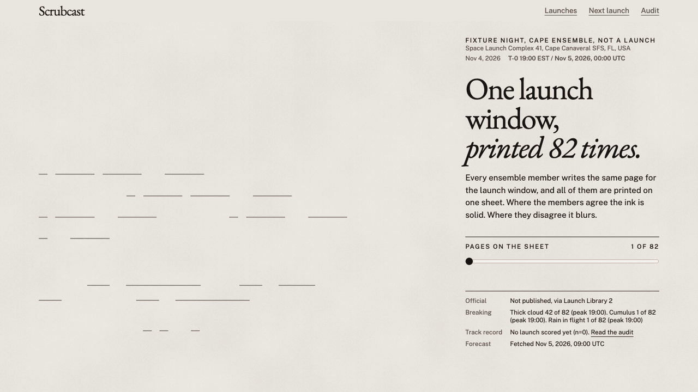

# Scrubcast

Follow the weather through the countdown.

Scrubcast shows which launch weather rules look at risk, hour by hour through the launch window. For Florida launches, you can read the official forecast beside it.



The demo shows a recorded Cape Canaveral weather fixture, not an actual launch.

**[Follow the next launch](https://scrubcast.intesarjawad.com/next/)** · [See the track record](https://scrubcast.intesarjawad.com/audit/)

Scrubcast cannot check every launch weather rule and does not predict whether a launch will be scrubbed. Use the official forecast for launch decisions.

Or follow it in a terminal:

```sh
uvx --from git+https://github.com/intesarjawad/scrubcast scrubcast next
```

No uv? `pipx run --spec git+https://github.com/intesarjawad/scrubcast scrubcast next`.

## What you see

- **One sheet, 82 forecasts.** The launch evening is typeset once per ensemble member and overprinted. Where the members agree the type prints solid; where they disagree it blurs. Point at a figure and its 82 values fan out against the rule's limit.
- **Each rule, hour by hour.** The share of ECMWF and GFS members that break it, with a label for how closely the model fields stand in for the rule.
- **The official forecast beside it.** For Florida launches, the 45th Weather Squadron's probability and named concerns sit above Scrubcast's numbers and are never merged with them.
- **What it cannot check.** Lightning, field mills, debris clouds, smoke plumes, triboelectrification and booster recovery are named on every page, not hidden.
- **What happened.** After T-0 the page stays for 90 days with the official concerns, Scrubcast's rule risks 24 hours out, and the outcome.
<!-- number: 90 days, src/scrubcast/build/past.py PAST_RETENTION -->

The demo at the top is one such sheet. Fixture night, not a launch: the recorded Cape Canaveral ensemble for 2026-11-05 00:00 to 04:00 UTC. The site publishes scheduled launches only.
<!-- number: window from tests/fixtures/worst_case/storm-night.json launch.window_start and window_end; tests/unit/test_public_docs.py checks it -->

## What Scrubcast is not

Scrubcast is not the launch weather officer, and it does not estimate whether a launch will scrub. The officer sees radar, field mills and the vehicle team's own limits. Scrubcast sees model output on a grid about 25 km wide. Where the two disagree, the official forecast is the one the launch director uses.
<!-- number: 25 km, the 0.25 degree grid of Open-Meteo's ecmwf_ifs025, src/scrubcast/sources/open_meteo.py _MODEL_NAMES -->

## How it works

Scrubcast checks every weather rule a forecast grid can see against 82 ensemble forecasts across the launch window.
<!-- number: 82 = 51 ECMWF + 31 GFS members, members_total written by src/scrubcast/build/site_data.py into latest.json; tests/unit/test_public_docs.py checks it against tests/fixtures/demo/latest.json -->


1. Four times a day, Scrubcast reads the next ten days of orbital launches from Launch Library 2 and fetches every ECMWF and GFS ensemble member for each pad from Open-Meteo.
2. Each weather rule is a versioned JSON file: the launch commit criteria from NASA-STD-4010A, the Falcon 9 liftoff wind limit, and per-site overrides.
3. For every member and every hour, the model fields become a stand-in for what the rule names, such as CAPE and cloud cover for the cumulus rule, and the stand-in is checked against the rule's threshold.
4. The board shows how many members break each rule at each hour. That share is model agreement, not a probability that the launch goes ([ADR 0002](docs/adr/0002-member-union-not-product.md)).
5. After the launch, the published forecasts are scored against station observations and the official forecast.
<!-- number: four runs a day, .github/workflows/collect.yml cron "20 3,9,15,21 * * *"; ten days, src/scrubcast/build/calendar.py FORECAST_HORIZON -->

Both ensembles output every 3 hours, so the hourly steps are Open-Meteo's interpolation. The stand-ins, thresholds and limits are in [docs/method.md](docs/method.md), each rule's source in [docs/rules.md](docs/rules.md), and the pads each rule covers in [docs/coverage.md](docs/coverage.md).

## Track record

Scrubcast scores its own forecasts after every launch. These badges read the latest audit from the site, and each number on the Audit view carries its sample size and baseline.

[](https://scrubcast.intesarjawad.com/audit/)
[](https://scrubcast.intesarjawad.com/audit/)
[](https://scrubcast.intesarjawad.com/audit/)

Three evaluations are kept apart, and no number moves between them ([ADR 0008](docs/adr/0008-three-evaluations-kept-apart.md)): a check of the rules against past Florida launches, a check of the models' surface forecasts, and the forward audit of Scrubcast's own forecasts.

## Run it yourself

Python 3.14, uv 0.13.7, Node 26.13.0 and gitleaks 8.30.1.

```sh
git clone https://github.com/intesarjawad/scrubcast && cd scrubcast
make setup
make demo
```

`make demo` replays a recorded forecast through the pipeline and serves the site at `http://127.0.0.1:5173/`, with no network requests. The same recording prints as a terminal board:

```sh
uv run scrubcast next --fixtures --count 1
```

```text
Scrubcast launch weather
Generated 2026-11-06 01:30 UTC. Members: 82.

1. Falcon 9 Block 5 | USSF-432
   Space Launch Complex 4E, Vandenberg SFB, CA, USA
   NET 2026-11-06 16:46 PST (2026-11-07 00:46 UTC)
   Window 2026-11-06 16:46 PST to 2026-11-06 20:46 PST
          (2026-11-07 00:46 to 2026-11-07 04:46 UTC)
   Official: not published
   Worst rule: No rule above 5%
```

`uv run scrubcast build` builds from today's data instead. `make check` runs every check. More in [docs/architecture.md](docs/architecture.md), [docs/operations.md](docs/operations.md) and [docs/recipes.md](docs/recipes.md), which has a bot, a calendar feed and a fork that re-scores every archived launch with your own threshold.

## Open data

No account, no cookies, no analytics. Every number downloads as open data under CC BY 4.0: `latest.json`, one JSON file per launch, `calendar.ics` and the audit ledger. [docs/data.md](docs/data.md) lists each file and its schema.

The weather inputs come from Open-Meteo's free tier, which is non-commercial. A commercial project needs an Open-Meteo plan or a replacement source.

## Where it fits

The 45th Weather Squadron's forecast is the official one. stagesep goes deeper at Starbase, Windy has more models and maps, and RocketLaunch.live has schedules and alerts. Scrubcast shows which rule the models break, member by member and hour by hour, beside the official number: [how they compare](docs/comparison.md).

## Contributing, licence and credits

Add a rule source, a site or a fix: see [CONTRIBUTING.md](CONTRIBUTING.md). Security reports: [SECURITY.md](SECURITY.md). Cite with [CITATION.cff](CITATION.cff). Code is MIT ([LICENSE](LICENSE)); published data is CC BY 4.0 ([DATA_LICENSE](DATA_LICENSE)).

Weather data by [Open-Meteo.com](https://open-meteo.com/) (CC BY 4.0). Launch data by [The Space Devs](https://thespacedevs.com/llapi) (Launch Library 2). Observations from the [Iowa Environmental Mesonet](https://mesonet.agron.iastate.edu/). Rule text from [NASA-STD-4010A](https://standards.nasa.gov/sites/default/files/standards/NASA/A/0/NASA-STD-4010A-Approved.pdf) and the [NASA Kennedy weather criteria fact sheets](https://www.nasa.gov/kennedy/about-kennedy/fact-sheets/).
