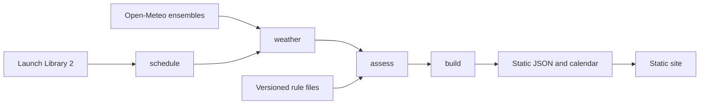

# Architecture

Scrubcast is a batch pipeline that writes static files, and a static site that
reads them. There is no application server.

| Step | Command | What it does |
|---|---|---|
| Schedule | `scrubcast schedule` | Saves upcoming orbital launches and their official forecast fields. |
| Weather | `scrubcast weather` | Refreshes ensemble forecasts for scheduled launch points inside a request-cost budget. |
| Assess | `scrubcast assess` | Counts, per rule and hour, the ensemble members that break each weather rule. |
| Build | `scrubcast build` | Publishes the launch data and calendar the site reads. |

`scrubcast collect` runs schedule and weather together and keeps the raw
response slices.

The Python package keeps its calculations free of I/O. `sources/` holds the
HTTP clients, `budget/` plans request cost, `rules/` loads the rule files,
`assess/` evaluates launches, `audit/` classifies launch outcomes and `build/`
writes the published contract. The site under `site/` is framework-free
TypeScript built by Vite: a launch list, a launch view with the window
scrubber, and share cards.

See [development notes](development.md) for tooling and version checks.

## Architecture decisions

- [0001: Static site without an application server](adr/0001-static-site-no-server.md)
- [0002: Use a member union for combined rule risk](adr/0002-member-union-not-product.md)
- [0003: Open-Meteo with a weather source boundary](adr/0003-open-meteo-with-swap-path.md)
- [0004: Store rules as versioned JSON](adr/0004-rules-as-versioned-json.md)
- [0005: Classify confidence and reference-only rules](adr/0005-confidence-classes.md)
- [0006: Keep ledger records in Git and slices in releases](adr/0006-ledger-in-git-slices-in-releases.md)
- [0007: Budget weather requests by cost](adr/0007-request-cost-budget.md)
- [0008: Keep three evaluations separate](adr/0008-three-evaluations-kept-apart.md)
- [0009: Preserve hourly denominators and consume the resolved rule selection](adr/0009-hourly-denominators-and-rule-selection.md)
- [0010: Preserve recorded demo evidence when official forecasts are absent](adr/0010-recorded-demo-evidence.md)
